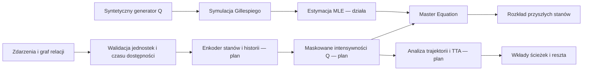

# Architektura badawcza TRAJECTA

**TRAJECTA — Trajectory-Aware Foundation Models for Dynamic Systems** to roboczy kierunek badawczy z czatu „Pragma i Master Equation”. Celem jest uczenie dynamiki między stanami na podstawie historii zdarzeń i jawne liczenie propagacji. Global Trade Matrix jest potencjalnym zastosowaniem, a nie definicją całego modelu.

Obecne repozytorium zawiera bibliotekę źródeł oraz małe laboratorium CTMC. Poniższa architektura neuronowa jest **propozycją do sprawdzenia eksperymentalnie**. Nie ma jeszcze trenowanego foundation modelu, implementacji TTA, integracji danych gospodarczych ani wyników transferu między domenami.

## Warstwy i kontrakty

| Element | Minimalny kontrakt | Stan |
| --- | --- | --- |
| Zdarzenie | `system_id`, `entity_id`, `event_time`, `available_at`, typ, wartości, jednostki, relacje | Plan |
| Słownik stanów | stabilne ID w obrębie systemu, opis, typ, maska dozwolonych przejść | Plan |
| Enkoder | historia dostępna do chwili decyzji → reprezentacje stanów i kontekstu | Plan |
| Generator | skończona macierz intensywności, nieujemne elementy poza przekątną, sumy wierszy 0 | Działa dla zadanej gęstej macierzy |
| Symulator | generator, stan początkowy, horyzont, jawny RNG → czasy rzeczywistych skoków | Działa |
| Estymator | w pełni obserwowane trajektorie → jednorodny generator MLE | Działa |
| Propagacja | wektor prawdopodobieństwa, generator, czas → rozkład i granica obcięcia | Działa |
| TTA / period folding | wkłady fizycznych ścieżek, cykle, reszta i składanie okresów | Plan; wymaga osobnej implementacji i walidacji |

Kod referencyjny znajduje się w [ctmc.py](../trajecta/ctmc.py). Używa gęstych macierzy i standardowej biblioteki Pythona. Nadaje się do małych układów oraz testowania równań, a nie do dużych sieci transakcyjnych.

## Matematyka i znaczenie stanu

Przyjmujemy **wektory wierszowe**:

\[
\frac{dp(t)}{dt}=p(t)Q,\qquad p(t)=p(0)e^{tQ}.
\]

Dla \(i\ne j\): \(q_{ij}\ge0\), \(q_{ii}=-\sum_{j\ne i}q_{ij}\). Jednostką \(Q\) jest odwrotność czasu. Intensywność wyjścia ze stanu to \(\lambda_i=-q_{ii}\); przy dodatniej intensywności średni czas pobytu wynosi \(1/\lambda_i\).

Proponowana głowica neuronowa może osobno modelować czas i wybór następnego stanu:

\[
\lambda_i=\operatorname{softplus}(a_i),\quad
b_{ij}=\operatorname{maskedsoftmax}_{j\ne i}(s_{ij}),\quad
q_{ij}=\lambda_i b_{ij}.
\]

Stan bez dozwolonych wyjść musi mieć jawnie \(\lambda_i=0\); nie wykonujemy softmax po pustym zbiorze. Dla stanów absorbujących potrzebny jest jawny mechanizm, ponieważ softplus sam nie daje dokładnego zera. Przekątną wyliczamy z sumy intensywności. Dla dużych grafów głowica powinna działać na dozwolonych krawędziach, z kontrolą pokrycia kandydatów, zamiast materializować wszystkie pary stanów.

Embedding opisuje cechy stanu; nie jest prawdopodobieństwem, wielkością produkcji ani bilansem materiałowym. Model CTMC opisuje losowy stan jednostki lub reżimu. Wolumeny handlu, ceny i produkcja wymagają osobnego modelu obserwacji oraz jawnych jednostek i ograniczeń.

Macierz techniczna input-output nie jest automatycznie generatorem CTMC. Zależność \(x=(I-A)^{-1}d\) ma inną semantykę i inne warunki od \(p(t)=p(0)e^{tQ}\). Moduł gospodarczy powinien określać, co oznacza stan, jak obserwuje się przejście i jak rozkład reżimów wpływa na bilans gospodarczy.

## Uczenie i niepełna obserwacja

Dla w pełni obserwowanego, jednorodnego CTMC log-wiarygodność warunkowa względem stanu początkowego wynosi:

\[
\log L=\sum_{i\ne j}N_{ij}\log q_{ij}-\sum_i T_i\lambda_i,
\qquad \widehat q_{ij}=N_{ij}/T_i.
\]

\(T_i\) obejmuje także końcowy odcinek bez skoku do końca obserwacji. Zerowa ekspozycja oznacza brak identyfikowalności danego wiersza, a nie stan absorbujący; obecny estymator zgłasza błąd. Brak obserwowanych skoków przy dodatniej ekspozycji daje zerowe intensywności w MLE, lecz wymaga ostrożności przy uogólnianiu na przyszłość. Wersja uczona może potrzebować priory lub regularyzacji.

Przy obserwacjach tylko w wybranych chwilach, ukrytych stanach lub błędach pomiaru ta funkcja celu nie wystarcza. Trzeba zdefiniować model obserwacji, marginalizację trajektorii i niepewność parametrów. [Neural MJP i Foundation MJP](../publications/BIBLIOGRAPHY.md#neural-mjp) są punktami odniesienia dla tego etapu, a nie funkcjami obecnego kodu.

## Propagacja, ścieżki i zmienne okresy

Kod używa uniformizacji: \(\nu=\max_i\lambda_i\), \(R=I+Q/\nu\), a następnie

\[
p(t)=\sum_{k=0}^{\infty}e^{-\nu t}\frac{(\nu t)^k}{k!}p(0)R^k.
\]

Indeks \(k\) liczy zdarzenia procesu Poissona, w tym wirtualne pozostanie w stanie. Nie liczy wyłącznie rzeczywistych skoków i nie oznacza jednej konkretnej trajektorii. `uniformization_terms` służy do nauki tej reprezentacji; nie należy podpisywać jego wyniku jako wkładów ścieżek TTA.

`propagate` dzieli długi okres, wybiera rząd obcięcia z granicy Chernoffa i zwraca rozkład z możliwym małym ubytkiem masy. Nie renormalizuje wyniku, aby nie ukrywać reszty. Zwrócona granica obejmuje obcięcie szeregu, a nie błędy zaokrągleń. Limit \(\nu t\le200000\) i tolerancja od `1e-14` do `1e-3` chronią zakres małego solvera; nie są gwarancją wydajności.

Dla generatora stałego odcinkami mnożymy propagatory chronologicznie:

\[
p_T=p_0e^{\Delta t_1Q_1}e^{\Delta t_2Q_2}\cdots e^{\Delta t_mQ_m}.
\]

Zwykle nie można zastąpić tego przez wykładnik sumy macierzy. Test dwóch nieprzemiennych okresów kontroluje konwencję. Dla wielu okresów należy także przenosić i sumować granice błędów; obecny interfejs wejściowy zakłada masę bliską 1, więc nie jest jeszcze pełnym solverem długiej sekwencji z narastającą resztą.

TTA i period folding należy wdrożyć dopiero po odtworzeniu algorytmu z [pracy Stanisza, Oettingena i Cetnara](../publications/BIBLIOGRAPHY.md#period-folding). Osobne testy powinny objąć rozgałęzienia, pętle, stany absorbujące, równe intensywności, resztę i zgodność z referencyjnym rozwiązaniem macierzowym.

## Granica interpretacji i następny krok

Zmiana krawędzi lub intensywności może służyć do analizy scenariuszy. Interpretacja jako efekt rzeczywistej interwencji wymaga dodatkowo identyfikacji przyczynowej, założeń o zmiennych ukrytych oraz walidacji mechanizmu. Sam dobry forecast tego nie zapewnia.

Najbliższy uzasadniony krok to benchmark wielu małych grafów o znanym generatorze, rozdzielonych między zbiory treningowe i testowe. Dopiero po nim warto dodać uczoną głowicę intensywności. Kryteria i kolejność prac: [plan eksperymentów](experiments.md).
